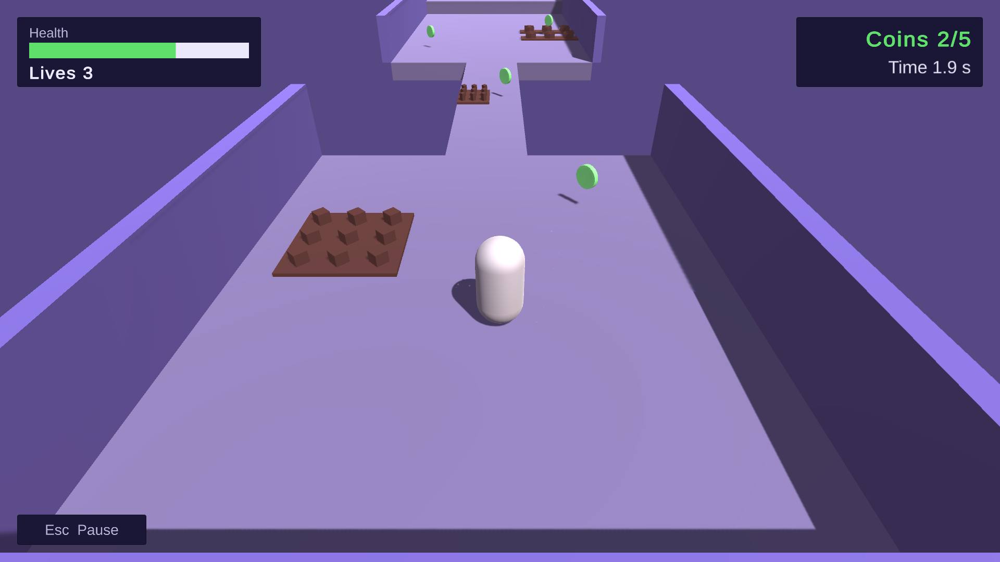
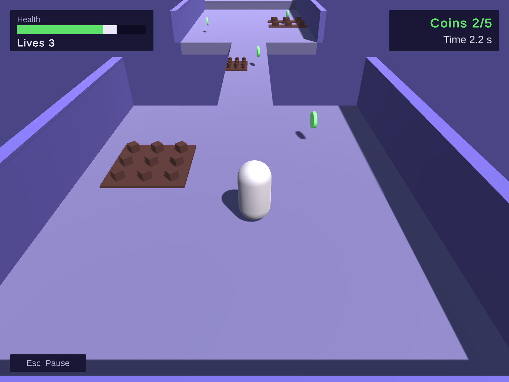
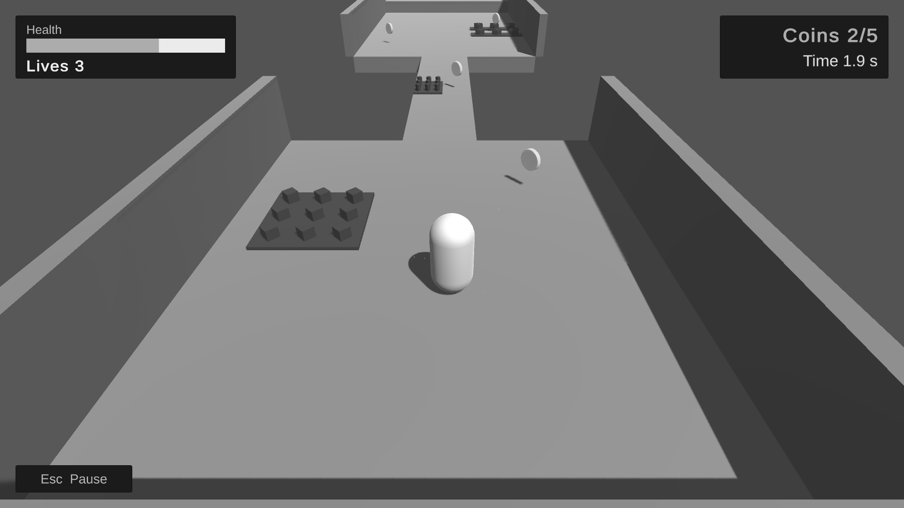
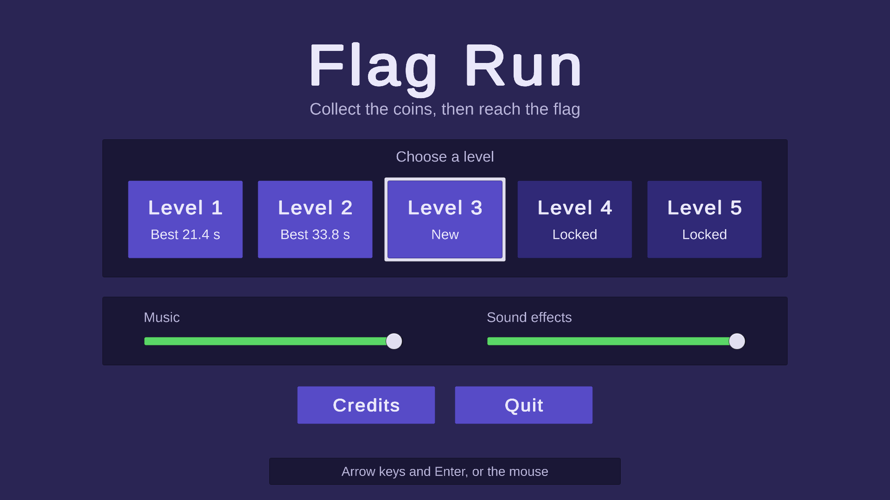
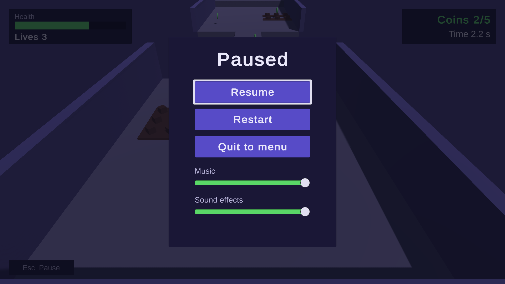
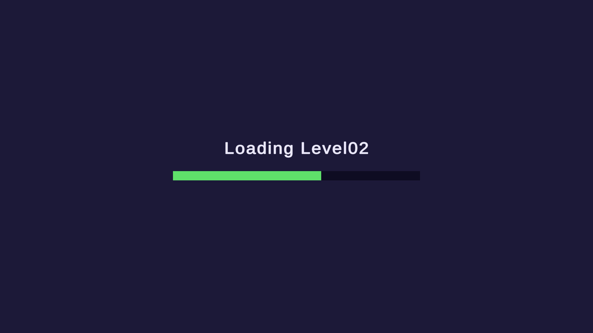
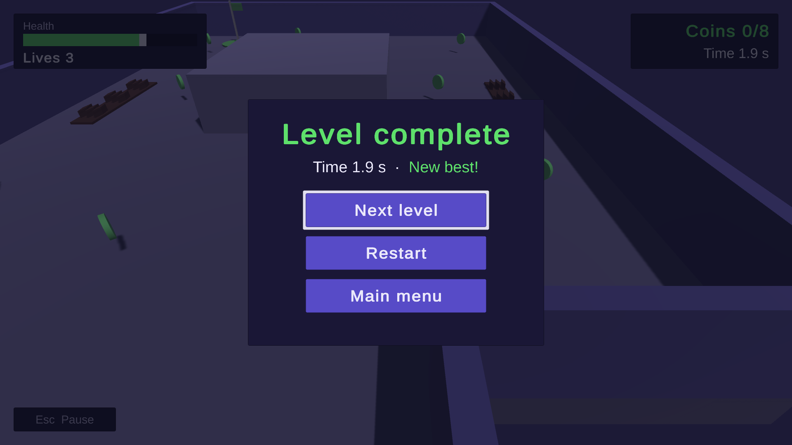
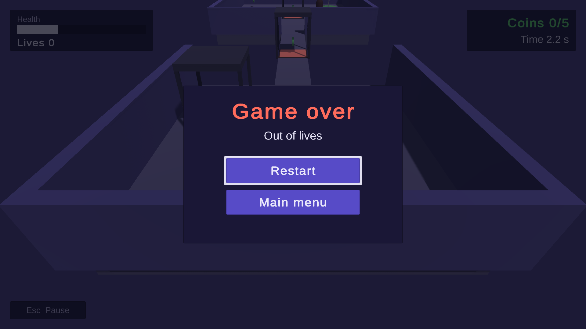
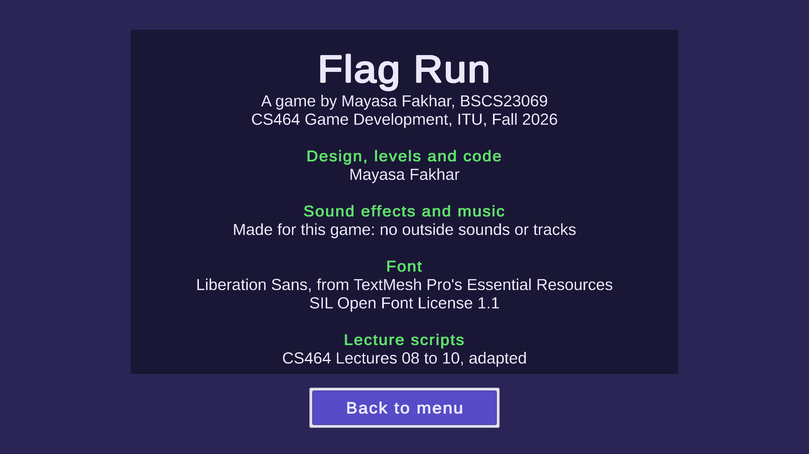

# CS464 Assignment 04 · Mayasa Fakhar · BSCS23069

**Video (90–180 s):** [VIDEO LINK]

This repo is a copy of my Assignment 03 repo (history and both branches), carried on in Unity 6.3 (6000.3.27f1). The five levels are the same ones, now called **Flag Run**, with a main menu before them and credits after.

- **Play:** open `Assets/Scenes/MainMenu.unity` and press Play. Any level also plays on its own.
- **Controls:** WASD or the arrow keys to move, Space to jump, Esc to pause. Every menu works with the arrow keys and Enter, or the mouse.
- **To win a level:** collect enough coins to open the goal, then reach the green flag.

## What I added

**Interface.** The HUD, the pause menu, the win screen and the game-over screen are one prefab, `Assets/Prefabs/HUD.prefab`, in all five levels. The health bar is two filled Images: a green fill and a pale lag bar behind it (`HealthBar.cs`, 0.4 s wait, then 0.8 of the bar per second). Coins, time and lives are TMP text. Every text sits on a solid dark panel, and each panel is anchored to its own corner. Pause, win and game over each select their first button as they open (`PauseMenu.Select`). Pointing at a button with the mouse selects it too, so there is only one highlight: a light ring round the selected button or slider.

**Sound.** `SfxPlayer` (four sources on the SFX group) plays every effect with PlayOneShot and a random pitch of ±2 semitones. There are seven effects: pickup, hit, jump, bounce, menu click, win and lose. Coins and pads play through it, so nothing is cut off when a coin is destroyed. `PersistentMusic` loops one track on the Music group. `Assets/Audio/Mixer.mixer` has Music and SFX groups with `MusicVolume` and `SfxVolume` exposed. The main menu and the pause menu have a Music slider and a Sound effects slider. `VolumeSlider` sits on the Canvas and sets `Log10(v) × 20` dB.

**Feedback.** A coin spawns `PickupSparkle`, one burst with Stop Action Destroy. `Health` raises `Damaged`, `Restored` and `Died`. Four listeners answer `Damaged`: `HealthBarListener` (the bar), `HurtSound`, `HitSparks` (one burst on the player) and `HitFlash` (a coral flash). The GameManager listens for `Died`. All of them use `+=` in OnEnable and `−=` in OnDisable.

**Level flow.** The Scene List is MainMenu 0, Level01–05 at 1–5 and Credits 6. `LevelLoader` is the only script that loads a scene. It loads in the background behind a bar (`Mathf.Clamp01(op.progress / 0.9f)`) and wraps to the menu after Credits. `SaveData` is the only script that spells a PlayerPrefs key. A win records the time, unlocks the next level and shows the win screen; its Next level button calls `LoadNext()`. `LevelSelect` sets the menu's five buttons from `SaveData`.

## Settings

| Part | Setting | Value | Why |
|---|---|---|---|
| A | Harmony · base hue | triadic · 246° | Indigo (246°) for the world and the panels, coral (6°) for danger, green (126°) for everything good: coins, the goal, pads, full health |
| A | Dark · mid · light | #1B1838 · #5B4ECF · #EAE8FA | Panels · buttons and walls · text and the player. Light on dark is 14.11 : 1, so the dark panel can carry any text |
| A | Accents | #FF6C5C · #5EE06B | Coral for hazards, low health and "Game over"; green for coins and the bar. In the level, hazards use coral at a dark value (#240806), so in grayscale they are the darkest thing on a mid floor, the player is the lightest, and coins are light but smaller and spinning (see the grayscale shot) |
| A | Coins text (#5EE06B) on its panel (#1B1838) | 10.01 : 1 | Measured with the WCAG formula. The other HUD pairs: time and lives 14.11, the muted "Health" label (#B8B4D9) 8.56, "Game over" in coral 6.12 |
| A | Button label (#EAE8FA) on the button (#5B4ECF) | 5.07 : 1 | Over 4.5 for 40 px bold labels. A locked level button is tinted darker, and its label is then 9.83 : 1 |
| B | Music · SFX groups, as mixed | 0 dB · 0 dB | The faders are what the sliders set. The balance is on the sources: the music's AudioSource is at 0.5 (−6 dB), so the effects sit on top of it |
| B | Slider at 1 · 0.5 · 0.0001 | 0 dB · −6.02 dB · −80 dB | `Mathf.Log10(v) * 20`, read back from the mixer with GetFloat in my test. The slider's minimum is 0.0001, because Log10(0) is minus infinity |
| C | Guard hum, in Level03 (and the guards in 04 and 05) | Logarithmic · Min 1.5 m · Max 12 m | 1.5 m is about the guard's size, so it's full volume when it's touching you. It notices you at 6 m, so at 6 m the hum is already a quarter as loud (−12 dB), a warning before it chases. At 12 m it stops fading at −18 dB, quiet but still telling you a guard is somewhere |
| C | Goal beacon, in Level01 (and every level) | Linear · Min 3 m · Max 30 m | 3 m is about the goal pad (2.5 m wide). Linear goes silent at 30 m, and my goals are 37–60 m from the start, so the bell isn't heard at the start and grows as you get close: it tells you you're getting there |
| C | AudioListener | On the player (`ListenerOnPlayer` on a Listener object), camera's removed | My camera follows from 6 m up and 8 m back, 10 m from the player. With the listener on it, a guard right beside the player would be 10 m away and almost silent. The menus have no player, so their camera keeps it |
| D | `unlocked` | int · default 1 | A new player, or one after Clear All PlayerPrefs, has Level 1 open and nothing else |
| D | `best1` … `best5` | float · HasKey first | No default makes sense for a best time, so `SaveData.HasBest` asks HasKey before reading, and the menu shows "New" for a level never finished |
| D | `MusicVolume` (and `SfxVolume`) | float · default 1 | Full volume until the player moves a slider. A default of 0 would read as −80 dB, silence |

## Answers

1. **What `Time.timeScale = 0` stops in my game, and what it doesn't:** It stops physics, so the player, the guards and the crushers freeze. It stops WaitForSeconds too, so the respawn delay and the crusher's cycle wait, and it stops the level timer. Update still runs, so `PauseMenu` can still read Esc, and `PlayerController.Update` has to return early. The health bar's lag, the hit flash, the loading bar and the credits roll use unscaled time. Audio isn't time, so I pause the world sounds with `AudioListener.pause`.

2. **What survives a LoadScene in my game, and how:** `PersistentMusic` and `SfxPlayer` survive through `DontDestroyOnLoad`. Each has the singleton check, so the copy in the next scene destroys itself. Statics survive as well: `PauseMenu.IsPaused`, `SfxPlayer.Instance`, `Time.timeScale` and `AudioListener.pause`. That's why every menu load calls `Resume()` first, and why `LevelLoader.Load` sets the time scale back to 1. PlayerPrefs are on disk, so they outlast quitting. The HUD, the loader and the GameManager are made again in each scene.

3. **Why every PlayerPrefs read in my game has a default:** On a first run, or after Clear All PlayerPrefs, none of my keys exist, so every read returns its default. `unlocked` defaults to 1, so Level 1 is open. The volumes default to 1, not to 0, which would mean −80 dB. A best time has no safe default, because 0 would beat every real time. So `SaveData` checks `HasKey` first, and the menu shows "New" instead of "Best 0.0 s".

4. **An exception a forgotten unsubscribe would throw, and why mine can't:** Suppose `HitFlash` used `+=` on an event that outlives the scene, like a static one, and never used `−=`. After a restart the event would still hold the old, destroyed HitFlash. The next hit would call it, and `image.color` would throw a MissingReferenceException. Every `+=` in my OnEnables has a `−=` in OnDisable, which runs when the scene unloads, so nothing old is left on the list. My events are also on the player's Health, not static.

## Checks before submitting

I ran these as play-mode tests:
- After clearing PlayerPrefs, only Level 1 is open.
- A win saves a best time and unlocks the next level, the menu shows both, and the loading bar reaches 100%.
- Three trips from the menu to a level and back leave one music player and one SfxPlayer.
- Pause, then arrow down and Enter on Restart: the level comes back running and the player can walk.
- Game over, then Restart, works the same way.
- A hit has four listeners and the bar's lag behaves as set.
- The slider gives 0 / −6.02 / −80 dB and is saved.
- Every scene has exactly one AudioListener.
- Winning Level 5 leads to Credits, and Credits leads back to the menu.

## Credits

- Every sound effect and the music track (`Assets/Audio`) were made for this game, so there are no outside sounds or tracks to credit.
- Liberation Sans · from TextMesh Pro's Essential Resources (Unity) · SIL Open Font License 1.1
- The scripts follow CS464 Lectures 08–10: HealthBar, PauseMenu, SfxPlayer, VolumeSlider, PersistentMusic, LevelLoader, SaveData, LevelSelect and ListenerOnPlayer.
